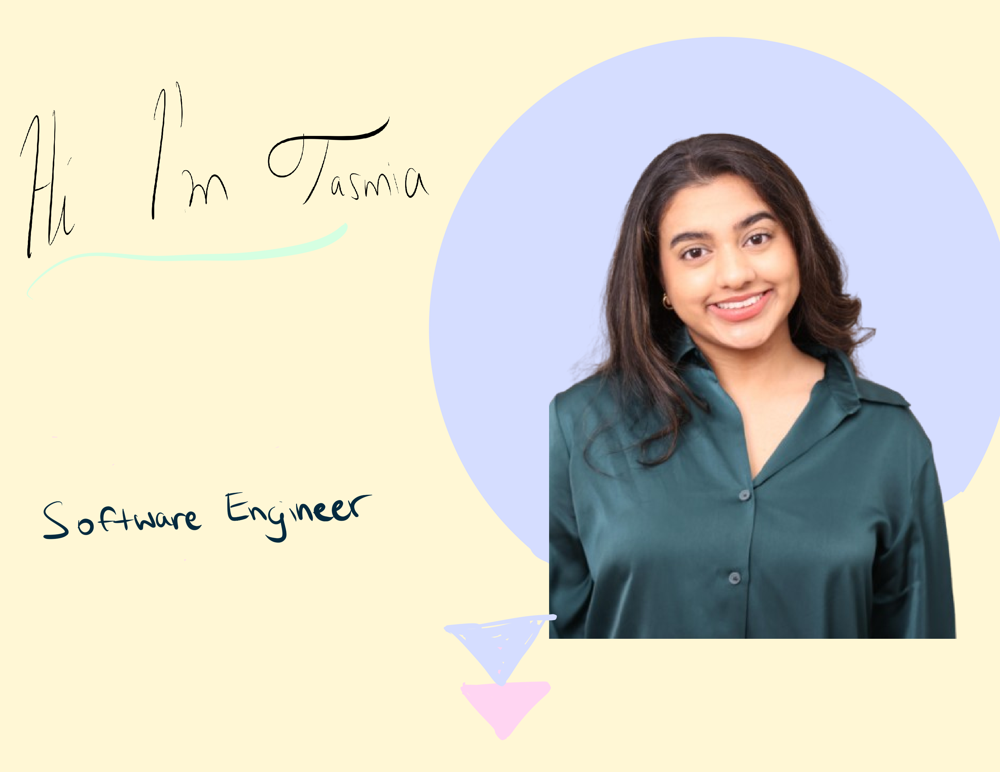
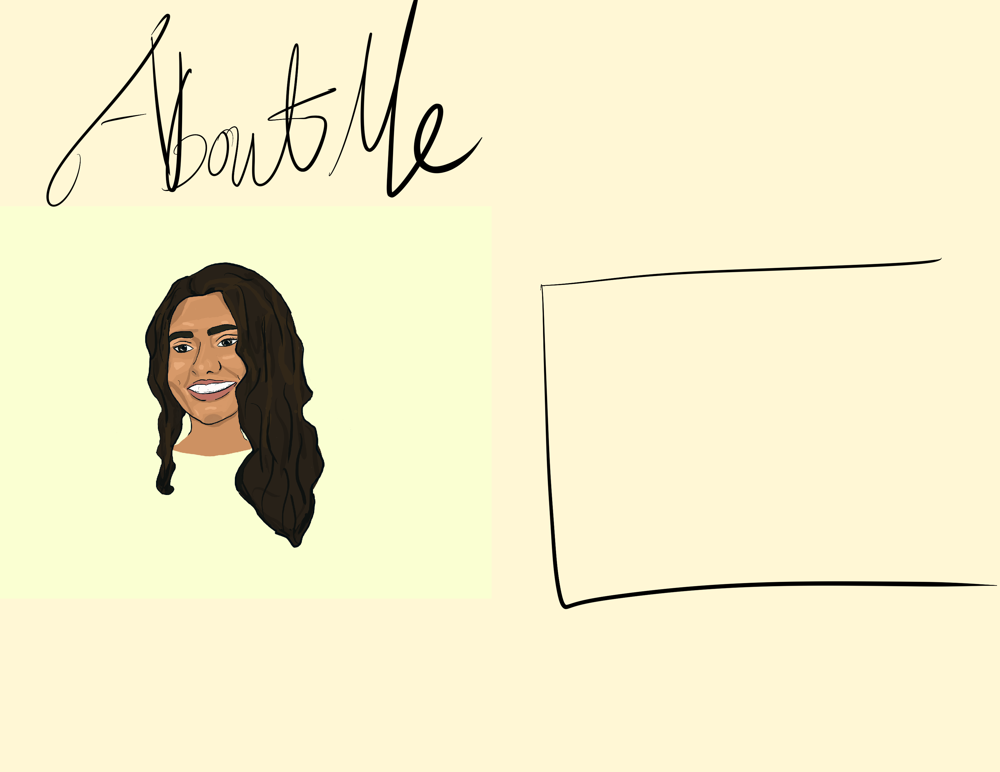
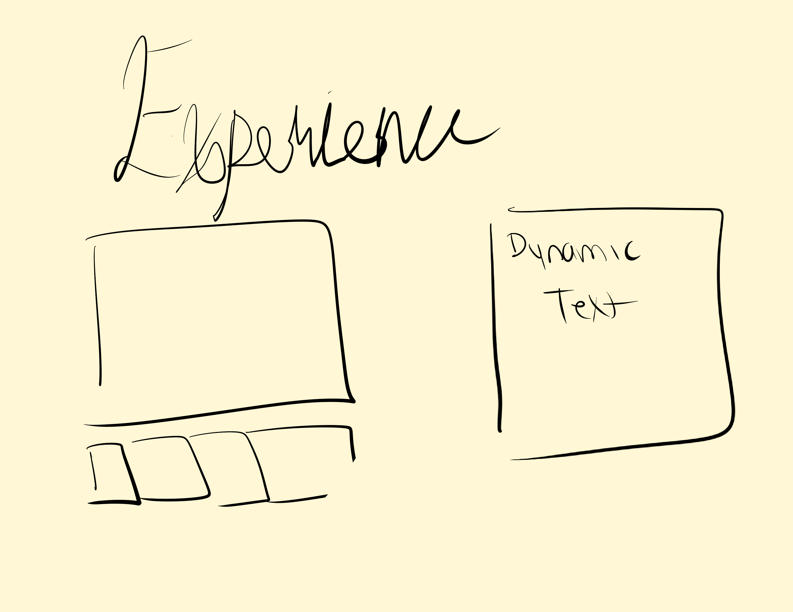
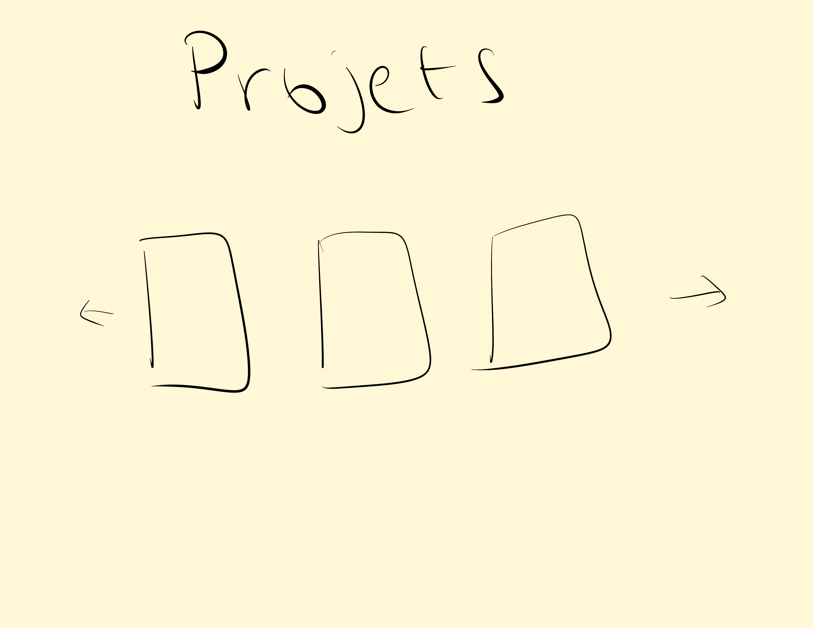
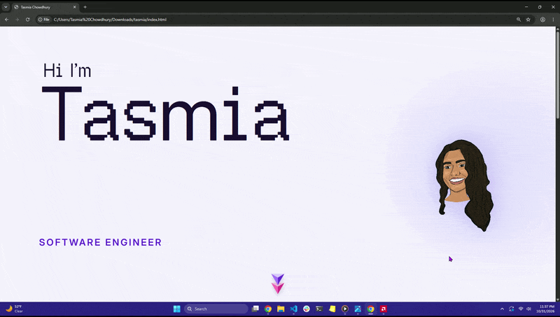
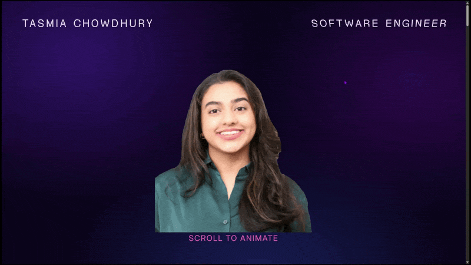
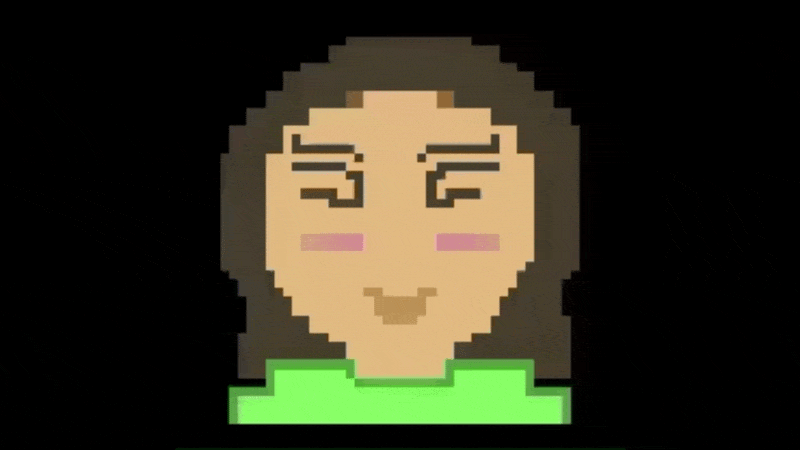

# Portfolio Website 

 This portfolio blends modern elements with the retro pixel aesthetic. I wanted the site to showcase my accolades but also feel **lively**.It starts unassuming with a standard headshot but as you scroll you're greeted with a warm character, bubblegum, and a pop! Hopefully it was fun for you to scroll through and you learned a little more about me. 

## The Visual Inspiration & Concept:
It was directly inspired by a typography poster on [behance](https://www.behance.net/gallery/130683597/Semihalf-rebranding/modules/740259299?utm_source=Pinterest&utm_medium=organic). I found it while scrolling through Pinterest and the blend of modernism with pixelation inspired me. Since I am currently working on a larger pixel project, where I’m (spending endless hours drawing city backgrounds 😅), bringing that aesthetic into my portfolio felt like the perfect bridge between my code and a current art style I'm exploring. I also found this cute scrollTrigger concept which was a massive inspiration for this build. Unfortunately, I can't find the original creator, but here is the [Pinterest Video](https://pin.it/5xk5W7IJE)

## The Process:
This site went through many iterations and ideations to get to where it is. 

1. **First Attempt:**:  I was inspired by “the old money theme”. But every animation kept fighting the antiquated UI. 

| | |
| :---: | :---: |
|  |  |
|  |  |

2. **Second Attempt:** I ditched the original cream color scheme, pivoted, and went full-send into the animation. So  
I animated everything, and when I say everything — I mean everything! Then I suddenly came across an article from Lottie about how having too many animations is a bit… distracting 😅

    

3. **Current State:** I reduced the amount of animations and made most of them tied to user interaction. The last step was redesigning the hero to tell a story with GSAP’s scroll trigger. 

    

## The Artwork:
Every frame and vector illustration on this site is **hand-drawn** by me in Procreate and Figma  

 <strong>No generative AI artwork. </strong>

The only exceptions are standard utility icons (GitHub, LinkedIn, email) and arrow symbols. I wanted this site to  
genuinely reflect my personal craft. The illustrations took quite a bit of time 😅, but I hope they put a smile on  
your face :)  
**Small** clip of artwork creation for sprite:

    

*This gif may or may not include the character design for my larger pixel project 😄*

## Tech stack and Scope Creep: 
I initially thought this was going to be a quick, small page, so I opted for vanilla HTML, CSS, JavaScript, and GSAP to drill my core fundamentals and estimated I would finish within 3 days. As the project kept getting redesigned, I ended up writing a lot of reusable component logic and was humbly reminded why tools like Tailwind exist 🤣. Still, keeping every section in its own dedicated JS and CSS file keeps the repo modular and readable and I hope it is useful to you! 

## Credit:
A special thanks to the GSAP team for their incredible YouTube tutorials, documentation, and CodePen showcases. 
Their [carousel gallery](https://demos.gsap.com/demo/infinite-card-slider/) was also a huge inspiration for this build.   
Behance poster: https://www.behance.net/gallery/130683597/Semihalf-rebranding/modules/740259299?utm_source=Pinterest&utm_medium=organic  
Procreate pixel brush tutorial: https://www.youtube.com/watch?v=tPQTGC5-_Is&list=PLDcc58dVCf2Y  
Scroll Trigger Inspiration: https://pin.it/5xk5W7IJE

## License
This project is open-source under the MIT License. Feel free to use or modify the code, but kindly give credit where applicable.  

 
MIT License    
Copyright (c) 2026 Tasmia Chowdhury

